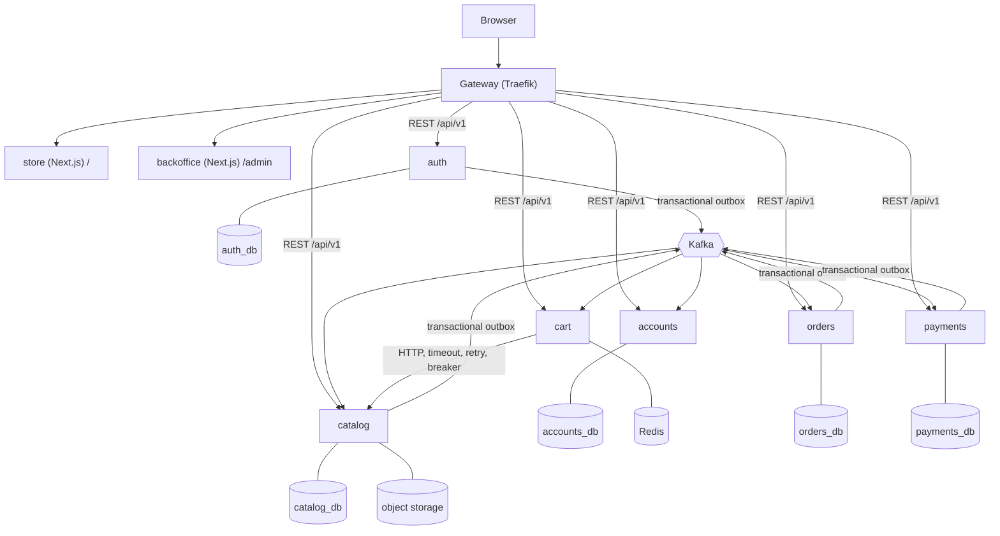
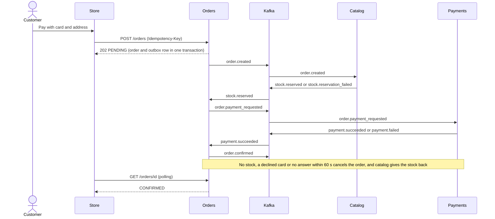

# Distributed Systems E-commerce

[](https://github.com/donaitorin/distributed-systems-ecommerce-monorepo/actions/workflows/backend.yml)
[](https://github.com/donaitorin/distributed-systems-ecommerce-monorepo/actions/workflows/frontend.yml)
[](https://github.com/donaitorin/distributed-systems-ecommerce-monorepo/actions/workflows/gateway.yml)

An e-commerce built as event-driven microservices: a Next.js store and backoffice, six Python services (auth, accounts, catalog, cart, orders, payments) with a PostgreSQL database each, Redis for carts, Kafka for every workflow between services and an S3-compatible object store for images and CSV files. One command starts all of it.

Quick links: [API reference](docs/api-reference.md) · [CSV import](docs/csv-import.md) · [Frontend](docs/frontend.md) · [Architecture decision records](docs/adr/README.md)

## 1. Quick start

**Prerequisites:** Docker with Compose v2 (tested with Docker 28 and Compose 2.38) and GNU Make. The stack uses about 3 GB of RAM. The first run downloads base images and dependencies and builds eight application images: under a minute when Docker already has the base images, several minutes on a machine that has never pulled them. Later runs are incremental. Ports 8000, 8001, 8088, 15432, 16379, 16380, 19000 and 29092 must be free on `127.0.0.1` (all are configurable in `.env`).

```bash
cp .env.example .env
make up          # builds the images, starts the stack (28 containers, a few are one-shot jobs) and waits until it is healthy
make ps
```

`docker compose up -d --build` also works from a machine with no images (checked), but it returns before the services are healthy, so give it a minute and look at `docker compose ps`. `make up` is the recommended way: it builds once and waits until everything is healthy.

| What | URL |
| --- | --- |
| Store | <http://127.0.0.1:8000/> |
| Backoffice | <http://127.0.0.1:8000/admin> |
| API docs | `/auth/docs`, `/accounts/docs`, `/catalog/docs`, `/cart-service/docs`, `/orders-service/docs`, `/payments-service/docs` |
| Kafka UI | <http://127.0.0.1:8088> |
| Gateway dashboard | <http://127.0.0.1:8001> |

**Demo users** (values from `.env.example`, for local use only):

| Role | Email | Password | How |
| --- | --- | --- | --- |
| Admin | `admin@example.com` | `demo-admin-change-me` | Created by the stack. Sign in at `/admin/login` |
| Customer | `dev-customer@example.com` | `demo-customer-change-me` | Created the first time you run `ROLE=customer make dev-token`. Or just register at `/register` |

`make dev-token` prints an admin access token and `ROLE=customer make dev-token` a customer one: `curl -s localhost:8000/api/v1/accounts/me -H "Authorization: Bearer $(make -s dev-token)"`.

**Test cards** for the simulated payment (any number of 12 to 19 digits; only the last four decide):

| Card ending | What happens |
| --- | --- |
| `1111` (and any other ending) | Approved at once, order `CONFIRMED` |
| `0000` | Declined, order `CANCELLED` (`payment_failed`) and the stock comes back |
| `9999` | The provider never answers: after 60 s the saga timeout cancels the order and releases the stock |
| `2222` | Approved after 90 s, when the order is already cancelled: the payment is refunded |

**The demo path** (about five minutes): sign in at `/admin/login`, open Products, then **Import CSV** and upload `data/sample-products.csv` (downloaded **Thursday 15 October 2026**; the report shows 88 importable rows, 4 errors and 3 warnings), review the report and confirm. Then open the store, search (`runing shoes` finds running shoes), add products to the cart, sign in as a customer, check out with card `1111` and watch the order become `CONFIRMED`; repeat with `0000` to see the cancellation. `make seed` loads 200,000 synthetic products to try search at volume.

**Looking inside** (credentials are in `.env`):

```bash
psql -h 127.0.0.1 -p 15432 -U catalog_user -d catalog_db        # password: CATALOG_DB_PASSWORD; also auth_db, accounts_db, orders_db, payments_db
docker compose exec redis-cart redis-cli -a demo-redis-cart      # the carts (REDIS_CART_PASSWORD)
AWS_ACCESS_KEY_ID=demo-access-key AWS_SECRET_ACCESS_KEY=demo-secret-key-change-me AWS_DEFAULT_REGION=us-east-1 \
  aws --endpoint-url http://127.0.0.1:19000 s3 ls                # buckets media and imports
```

Kafka UI shows the topics (`orders.events`, `inventory.events`, `payments.events`, `catalog.events`, `auth.events`, `imports.jobs`, and a `.dlq` topic for each). Stop with `make down` (never add `-v` unless you want to lose the data).

## 2. Requirement map

| Challenge requirement | Where it lives | How to try it |
| --- | --- | --- |
| Local database | PostgreSQL 17 in `docker-compose.yml`, one database and one user per service (`infra/postgres/init/`) | `make up`, then the `psql` command above |
| Product CRUD with UI | Catalog API and backoffice `/admin/products`: list, create, edit with `If-Match` conflict dialog, delete, images, categories | Sign in as admin |
| CSV import (file downloaded Thursday 15 October 2026) | `data/sample-products.csv`, `/admin/products/import`, API `/api/v1/imports`; [rules and report](docs/csv-import.md) | Upload the file, read the report, confirm |
| Search with UI | Store `/products`: full text with typo tolerance, filters, sorts, cursor pagination, state in the URL | `runing shoes`, filters, Back and Forward |
| Purchase with simulated payment | Store: product, cart, checkout, `/orders/{id}`; the saga below; payments by card ending | Test cards above |
| Runs in Docker | 28 compose services (a few are one-shot jobs), multi-stage non-root images, health checks, `make up` | `make up && make ps` |
| README with decisions, approach and alternatives | This file and 20 [ADRs](docs/adr/README.md) | Sections 4 and 5 |
| No comments in the code | `make check-comments` (backend, frontend and scripts) runs in CI | `make check-comments` |
| Solution on GitHub | [donaitorin/distributed-systems-ecommerce-monorepo](https://github.com/donaitorin/distributed-systems-ecommerce-monorepo) with three CI workflows | Badges above |

## 3. Architecture



Each service owns its data and starts with only its own infrastructure. Everything between services goes through Kafka except one synchronous call, cart to catalog. Events share one envelope (`libs/contracts`), are written through a transactional outbox in the same transaction as the change, and are consumed idempotently. Each service has an API container and a worker container (outbox relay and consumers). The auth service signs RS256 tokens; every other service and the Next.js servers validate them against its JWKS.

**A purchase is a saga orchestrated by the orders service** ([ADR 0014](docs/adr/0014-orders-saga-and-idempotency.md)):



States: `PENDING`, `STOCK_RESERVED`, `PAID`, `CONFIRMED`, `CANCELLED`. Every transition is a row in `order_status_history`. Stock is taken by one atomic `UPDATE ... WHERE price = :expected AND stock >= :qty`, so two buyers of the last unit cannot both win and a changed price cancels the order ([ADR 0013](docs/adr/0013-stock-reservations.md)).

## 4. Key decisions and the alternatives considered

| Decision | Alternatives considered | ADR |
| --- | --- | --- |
| Saga over Kafka with an outbox and idempotent consumers | One synchronous checkout call (simpler, but couples the availability of three services) | [0004](docs/adr/0004-csv-import-and-messaging-core.md), [0011](docs/adr/0011-consumers-that-skip-the-claim.md), [0014](docs/adr/0014-orders-saga-and-idempotency.md) |
| SeaweedFS behind an `ObjectStorage` port | MinIO (archived), building MinIO, a vendor image, Garage, RustFS | [0001](docs/adr/0001-object-storage-seaweedfs.md) |
| Search with PostgreSQL full text, trigram fallback and keyset cursors | A single `fts OR trigram` predicate (400 to 650 ms against 2 to 12 ms), OpenSearch later | [0002](docs/adr/0002-catalog-search-and-keyset-pagination.md) |
| Validated image uploads, WebP renditions, storage outside `/ready` | Presigned direct uploads (the path for much higher volume) | [0003](docs/adr/0003-product-images.md) |
| CSV validated by a worker, imported only after explicit confirmation | Validating inside the request or in an API background task (lost if the process dies) | [0004](docs/adr/0004-csv-import-and-messaging-core.md) |
| RS256 JWTs checked locally with a JWKS; rotating refresh tokens with reuse detection | A zero grace window (every race would log the user out) | [0005](docs/adr/0005-auth-tokens-and-signing-keys.md) |
| Accounts profile fed by events and a lazy insert, last write wins by timestamp | A per-user version number (only needed if several producers wrote roles) | [0006](docs/adr/0006-accounts-profile-consistency.md) |
| Two Next.js apps joined with Multi-Zones, `httpOnly` cookies, nonce-based CSP | Module Federation, one app with route groups | [0007](docs/adr/0007-frontend-zones-session-and-csp.md) |
| Rate limits at the gateway keyed on the real client behind a trusted hop | Limiting inside the Next.js servers, a forgeable custom header | [0008](docs/adr/0008-gateway-forwarded-headers-and-rate-limits.md) |
| Backoffice reads and writes only through the Next.js server; streamed uploads | Calling the API from the browser (it cannot read `httpOnly` cookies) | [0009](docs/adr/0009-backoffice-data-access-and-uploads.md) |
| Cart in Redis with a bounded projection of catalog events, accepted prices | A TTL entry for every event (a 200,000 product import would write 200,000 keys) | [0012](docs/adr/0012-cart-service.md) |
| Provider port with a simulated adapter; Stripe would plug in as an adapter and a webhook | A real Stripe integration (the design is recorded, not built) | [0015](docs/adr/0015-payments-provider-port-and-stripe.md) |
| Server-built orders and one idempotency key per attempt | Trusting the browser's cart and prices | [0016](docs/adr/0016-store-checkout-and-order-tracking.md) |
| Timeouts everywhere, retries only for idempotent reads, a circuit breaker on cart to catalog | Retrying writes, a breaker on every call | [0018](docs/adr/0018-http-resilience.md) |

## 5. Resilience

[ADR 0018](docs/adr/0018-http-resilience.md) lists every synchronous HTTP call with its timeout and retry policy; [ADR 0019](docs/adr/0019-failure-scenarios-and-quality-gates.md) explains the scenarios and gates.

| Pattern | Where | See it work |
| --- | --- | --- |
| Transactional outbox, at least once | `libs/messaging`, one table per service | Stop Kafka, place an order: it is accepted and waits as `PENDING` |
| Idempotent consumers | Claim table or compare-and-set handlers | A republished event changes nothing |
| Retries with backoff, dead letter topics | `EventConsumer`: 3 attempts, then `<topic>.dlq`, the partition keeps moving | `make check-dead-letters` |
| `Idempotency-Key` on `POST /orders` | orders service | Repeat a request: same order, `Idempotent-Replay: true` |
| Saga timeout | The orders worker cancels orders older than `ORDERS_SAGA_TIMEOUT_SECONDS` (60) | Stop payments, place an order |
| Timeouts, read retries and a circuit breaker | `libs/resilience`, cart to catalog, `packages/api-client` | Stop catalog and add a product to the cart: a fast `503` with `Retry-After`; the cart still loads |

**Dead letters** carry a safe error summary (field paths and error codes, never payload values). `make dlq-inspect TOPIC=orders.events.dlq` lists them and `make dlq-replay TOPIC=orders.events.dlq ALL=1` (or `OFFSETS="0:12 3:4"`, add `DRY_RUN=1` to preview) publishes them again to the original topic, once per original message even when several consumer groups dead-lettered it (it reports, for example, `6 dead letters, 4 duplicates skipped` and the groups that failed). Replay is all or nothing and safe to repeat because consumers are idempotent.

**Failure scenarios** exist as integration tests (Testcontainers, part of `make test-backend`) and as a script against the running stack:

| Scenario | Result | Test | Script |
| --- | --- | --- | --- |
| Payments stopped during a purchase | The order waits, the saga timeout cancels it and the stock returns; when payments is back the queued charge is made and refunded at once, and new orders confirm | `backend/tests/e2e/test_payments_outage.py` | `make check-failure-scenarios SCENARIO=payments` |
| Kafka stopped and started | Orders and registrations are accepted, events wait in the outbox, and after the restart the saga completes with every effect applied once | `backend/tests/e2e/test_kafka_outage.py` | `make check-failure-scenarios SCENARIO=kafka` |
| A malformed message in any topic | It lands in that topic's `.dlq` and the partition is not blocked | `backend/tests/test_malformed_messages_per_topic.py` | `make check-dead-letters` |
| Catalog stopped | Adding to the cart fails fast once the breaker is open; the cart page loads | `backend/services/cart/tests/integration/test_catalog_outage.py` | stop catalog, `PUT /api/v1/cart/items/{sku}` |

`make check-failure-scenarios` takes about four minutes, stops and starts `payments`, `payments-worker` and `kafka` and restarts them at the end. It orders as the customer `scenario-bot@example.com`, creates `SCEN-*` products and removes them through the catalog API when it finishes. No API deletes users or orders, so `scenario-bot`, a `scenario-reg-<timestamp>` user and their orders stay; for a pristine run use a disposable stack: copy the repository, `export COMPOSE_PROJECT_NAME=ecommerce-scratch`, use another `.env` with different host ports and a different frontend subnet (the compose project name does not separate host ports, and the subnet is fixed; see [ADR 0020](docs/adr/0020-operational-notes-and-known-limitations.md)). Keep a Kafka outage shorter than the saga timeout.

## 6. Testing and quality gates

| Suite | What | Size |
| --- | --- | --- |
| Backend (`make test-backend`) | pytest; unit tests plus Testcontainers suites (Postgres, Kafka, Redis, SeaweedFS) and the end-to-end saga | 2,732 tests, 97.7% coverage, 501 of them need Docker |
| Frontend (`make test-frontend`) | Jest and Testing Library with jest-axe, one suite per package | about 1,900 tests, 96 to 99% statements |
| Storybook (`make test-storybook`) | Every story, with axe | 316 checks |
| Scripts (`make test-scripts`) | The comment checker, the Node guard, the coverage and CSP checks | 82 tests |

- Coverage thresholds fail the build: 85% overall and, in `make test-backend`, 85% for every lib and service separately; 85% for every frontend package.
- `make lint` runs ruff, mypy in strict mode, ESLint and the TypeScript compiler. `make check-comments` fails on any comment or docstring. `make check-openapi` fails when the generated API types are stale.
- CI: `backend` (lint, all tests with Docker available, per-package coverage, image builds with a non-root check), `frontend` (lint, typecheck, tests, comments, Storybook with axe, OpenAPI, image builds that start without any backend) and `gateway` (an isolated proof of the rate limits and of the trusted forwarded headers).
- Live checks against a running stack: `make check-routes`, `make check-dead-letters`, `make check-failure-scenarios`, `make check-not-found-csp`, `make check-rate-limit`.
- Accessibility: automated checks only (axe, contrast test, Radix keyboard behaviour). A manual screen-reader pass was **not performed**; see [docs/frontend.md](docs/frontend.md).
- Frontend commands need the Node version of `.nvmrc` (`nvm install && nvm use`) and Corepack. The Make targets stop with a clear message if the Node major differs.

## 7. Known limitations

Each item is explained in [ADR 0020](docs/adr/0020-operational-notes-and-known-limitations.md).

- A Kafka outage longer than the saga timeout (60 s) cancels the orders that were waiting.
- After a payments outage a cancelled order is charged and then refunded (an `expires_at` on `order.payment_requested` would avoid the charge).
- The circuit breaker lives in each cart instance.
- Adding to the cart is read-then-write (the store reads the quantity and sets the new total; the service reads the line and writes it), so two simultaneous adds of the same product can lose one.
- The refresh-token deduplication of the Next.js servers is per process. The CSP nonce makes every page dynamic. Image keys are recovered from URLs, so catalog and cart need the same `MEDIA_PUBLIC_BASE_URL`.
- The frontend network `10.250.10.0/28` is fixed in three files (`docker-compose.yml`, `infra/gateway/traefik.yml`, `infra/gateway/dynamic/auth.yml`; [ADR 0020](docs/adr/0020-operational-notes-and-known-limitations.md) has the one-line change); it can collide with some VPNs and two stacks cannot run side by side. Stacks created before the `ip_range` change need one `docker compose down` (never `-v`).
- `BUILDX_NO_DEFAULT_ATTESTATIONS=1` is set so `make up` does not recreate containers on every run.
- The Storybook test runner is deprecated (migration path: the Vitest addon); MSW is not used (tests mock `fetch` at the Next.js server boundary).
- Users created before the outbox existed have no `user.registered` event; accounts creates their profile on first use.
- No retention jobs yet (processed events, imports, orphaned images, expired refresh tokens). OpenTelemetry was skipped: logs are JSON with a request id and a correlation id.

## 8. Future work

- **Observability:** OpenTelemetry tracing with Jaeger; Prometheus metrics and Grafana dashboards (the breaker already exposes listener hooks for them).
- **Resilience:** a circuit breaker whose state is shared between cart instances; retention jobs for processed events, imports and orphaned objects.
- **Payments:** a real Stripe adapter with a webhook ([ADR 0015](docs/adr/0015-payments-provider-port-and-stripe.md)); an `expires_at` guard so a stale payment request is never charged.
- **Delivery and infrastructure:** publishing images to GitHub Container Registry; Kubernetes manifests for kind; Terraform for topics and buckets; a Lambda on LocalStack that issues the receipt for `order.confirmed`; a configurable frontend subnet.
- **Testing:** Playwright end-to-end tests over the purchase flow; a Locust load test; a manual screen-reader pass.

## 9. Reference

**Commands**

| Command | Description |
| --- | --- |
| `make up`, `make down`, `make ps`, `make logs SERVICE=kafka` | Start (and wait for health), stop, list, follow logs |
| `make seed COUNT=200000` | Load synthetic products (idempotent) |
| `make dev-token` | Print an access token (`ROLE=customer` for a customer) |
| `make test`, `make test-backend`, `make test-backend-unit`, `make test-frontend`, `make test-storybook`, `make test-scripts` | Tests |
| `make lint`, `make check-comments`, `make check-openapi`, `make openapi` | Static checks and generated API types |
| `make check-routes`, `make check-rate-limit`, `make check-dead-letters`, `make check-failure-scenarios`, `make check-not-found-csp` | Checks against a running stack (see above) |
| `make dlq-inspect`, `make dlq-replay` | Dead letter operations |
| `make install-frontend`, `make storybook` | Frontend setup and Storybook on port 6006 |

**Repository layout**

```text
backend/     Python monorepo (uv workspaces): services/ (six services), libs/ (contracts, messaging, resilience, auth, storage, web, observability)
frontend/    Next.js monorepo (pnpm and Turborepo): apps/store, apps/backoffice, packages/
infra/       Gateway (Traefik), PostgreSQL init, Kafka topics, object storage bootstrap
docs/        API reference, CSV import, frontend notes, architecture decision records
scripts/     Live checks, the comment checker, the Node guard and the coverage check (with tests)
data/        sample-products.csv
```

**Configuration** lives in `.env` (copied from `.env.example`): ports, demo passwords, timeouts and breaker settings. All values are demo values; change them if the stack is reachable from anywhere other than your machine.

### How this was built (AI usage)

> **Draft wording, for the author to review before delivery.**

The project followed a written plan of stages (E0 to E16: base environment, backend foundations, catalog, search, images, CSV import, auth, accounts, frontend foundations, backoffice, store, cart, orders and payments, checkout, resilience and this documentation; observability was planned as E15 and skipped). Each stage was split into parts and built with Claude Code under the rules in `CLAUDE.md`: work on one part at a time and only what its scope says, never start the next part alone, ask when the plan does not cover a decision (or state the assumption), prefer the simplest solution, no comments or docstrings, English everywhere, every change with tests, and never run `git commit`, `git push` or create branches. At the end of each part Claude Code stopped and reported what it built, its assumptions, the exact commands to verify it, the test and coverage numbers and a suggested split into Conventional Commits.

A second assistant reviewed each report and wrote the prompt for the next part. The author then verified the work by running the commands in the report and committed by hand, so every commit in the history was read and run by a person. Decisions that mattered were written down as ADRs (`docs/adr/`). The plan itself (`.planning/`) is a local working note and is not versioned.
